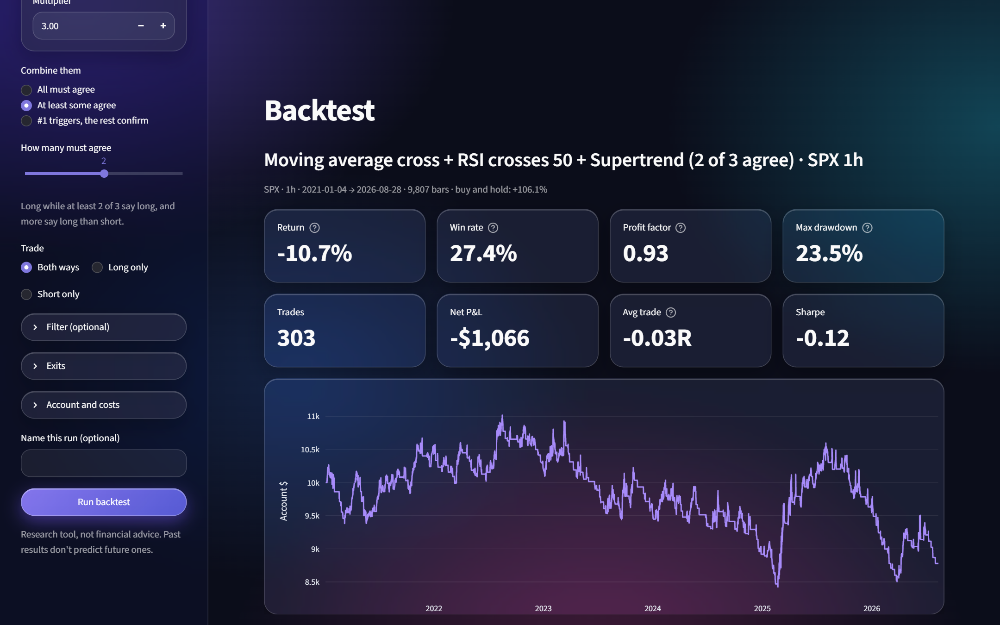
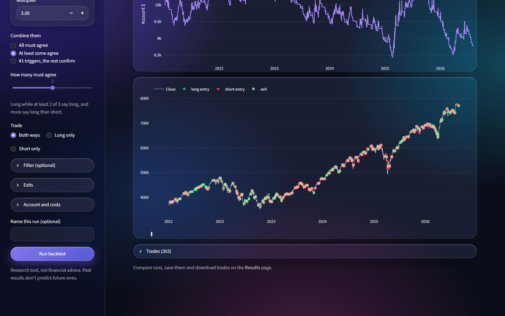
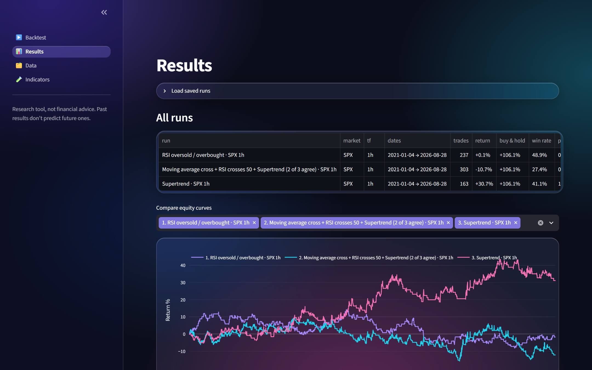
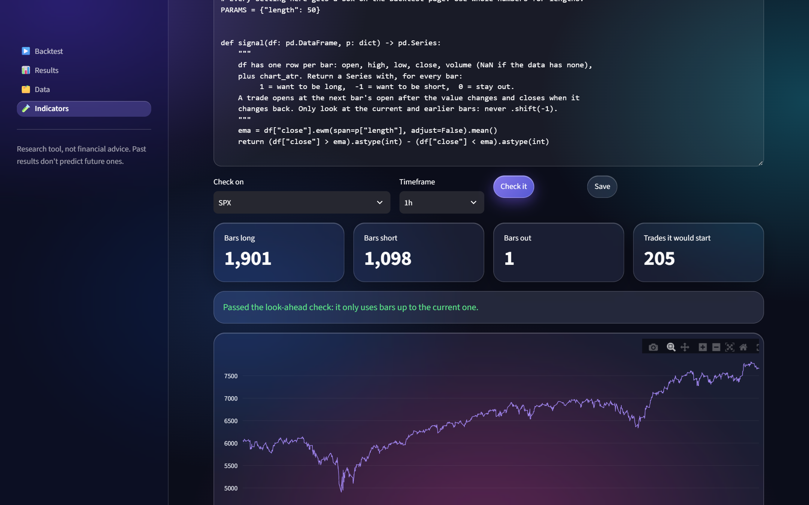
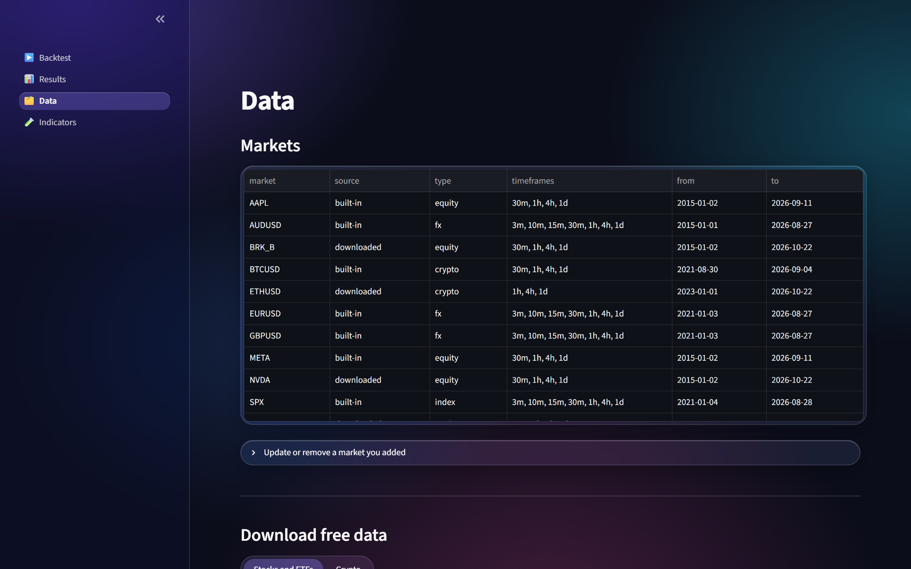

# Fafnir Backtesting Engine

Test trading ideas without writing a backtester. Pick a market, stack up to five indicators (or write
your own), and see exactly what would have happened: every trade, the equity curve, drawdown and the
stats that matter, on an engine built so it can't peek at the future.

> Research tool, not financial advice. Past results don't predict future ones.



<table>
  <tr>
    <td></td>
    <td></td>
  </tr>
  <tr>
    <td align="center"><sub>Every entry and exit on the chart</sub></td>
    <td align="center"><sub>Compare runs side by side</sub></td>
  </tr>
  <tr>
    <td></td>
    <td></td>
  </tr>
  <tr>
    <td align="center"><sub>Write your own indicator, checked for look-ahead</sub></td>
    <td align="center"><sub>Download free stock and crypto data</sub></td>
  </tr>
</table>

## Quick start

Tested on Python 3.12.

```bash
python -m pip install -r requirements.txt
python -m streamlit run gui/app.py
```

It opens at http://localhost:8501. A fresh copy has no market data, so:

1. Go to **Data** and download a few stocks, ETFs or crypto pairs (free, no account), or upload your
   own CSV.
2. Go to **Backtest**, pick the market and indicators, and press **Run backtest**.
3. Compare runs, look at every trade and download them on **Results**.

## What you can do

**Backtest**
- 20 built-in indicators: moving-average cross, MACD, RSI, Stochastic, Bollinger, Keltner, Donchian
  (Turtle), CCI, Williams %R, Parabolic SAR, Supertrend, Ichimoku, ADX/DI, Aroon, rate of change, SMI,
  EMA ribbon and more, each with its own settings.
- **Combine up to five**: all must agree, at least N agree, or the first one triggers and the rest
  confirm.
- An optional filter (trade only with the 200 EMA, only when ADX shows a trend, ...), long/short/both,
  ATR stops, exit on signal flip, take profit, risk-per-trade or fixed-margin sizing, spread, slippage
  and commission.

**Results**: every run in one table against buy-and-hold, overlaid equity curves, drawdown, the full
trade list as CSV, the exact settings used, and save/load of runs.

**Data**
- Download ~50 popular stocks and ETFs (or any Yahoo Finance ticker) and crypto pairs from Coinbase
  or Kraken, and update them to today later. Yahoo's free data gives daily bars back to 2015 but only
  2 years of 1-hour and 60 days of 30-minute bars.
- Upload your own OHLC(V) history as CSV or Parquet (TradingView, MetaTrader, Dukascopy, Binance and
  most broker exports work). Any bar size; every larger timeframe is built from it.

**Indicators**: browse the built-ins, or write your own in the app.

## Writing your own indicator

An indicator is one Python file in `custom_indicators/` (or written in the app's editor). It returns,
for every bar, `1` (want to be long), `-1` (want to be short) or `0` (stay out). The engine handles
entries, stops, exits, costs and sizing exactly as it does for the built-ins.

```python
import pandas as pd

NAME = "Above the EMA"
DESCRIPTION = "Long above the EMA, short below."
PARAMS = {"length": 50}          # each one gets a box on the Backtest page


def signal(df: pd.DataFrame, p: dict) -> pd.Series:
    ema = df["close"].ewm(span=p["length"], adjust=False).mean()
    return (df["close"] > ema).astype(int) - (df["close"] < ema).astype(int)
```

`df` has `open`, `high`, `low`, `close`, `volume` (NaN when the data has none) and `chart_atr`.
**Check it** runs the indicator on real bars and recomputes it on cut-off history: if any past value
changes, it was reading the future (a `.shift(-1)`, a centered window) and the app says so before a
too-good-to-be-true backtest fools you. Two working examples ship in `custom_indicators/`.

Custom indicators are ordinary Python running on your machine, which is why the app only listens on
localhost (`.streamlit/config.toml`).

## How the no-look-ahead guarantee works

- Bars are stamped at their open and only published once the source covers them to the close.
- Signals are evaluated on bar *t*'s close; fills happen at bar *t+1*'s open plus slippage and half the
  spread. Intrabar stops fill at the stop or the gap open, whichever is worse.
- Higher-timeframe data only uses bars that had already closed.
- The test suite drops the last bar and checks that nothing earlier changes, for every indicator.

## Command line

The GUI sits on top of a plain Python engine (`saty_bt/`) driven by `config.yaml`:

```bash
python -m saty_bt.run --strategy indicator_lab --tf 1h --assets NVDA \
    --set strategies.indicator_lab.system=rsi_revert --set risk.halt_drawdown_pct=100
```

Results land in `results/<run_id>/` (`trades.csv`, equity curves, `summary.json`). Beyond the indicator
lab there are level-based strategies built on Saty Mahajan's ATR Levels, Pivot Ribbon, Phase Oscillator
and Volume Stack, plus a sweep / walk-forward optimizer (`saty_bt/sweep.py`, `saty_bt/optimize.py`).

**Add a strategy**: create `saty_bt/strategies/my_strategy.py` with
`build_signals(f, scfg, acfg, cfg, gates_enabled=None)` returning the entry, stop and target columns
(see `indicator_lab.py`), register it in `saty_bt/strategies/__init__.py` and add a block under
`strategies:` in `config.yaml`.

**Add a market from the command line**: add a block under `assets:` in `config.yaml` with a `source`
(`yfinance`, `ccxt` or `csv_import`), then `python -m saty_bt.data.build --assets NAME`. The forex and
SPX entries in `config.yaml` expect HistData downloads; `scripts/import_histdata.py` converts them.

## Tests

```bash
python -m pytest tests -q
```

Tests that replay real market data skip themselves when that data hasn't been downloaded.

## Project layout

```
gui/                Streamlit app: Backtest, Results, Data and Indicators pages
custom_indicators/  your indicators (two examples included)
saty_bt/            the engine: data, indicators, strategies, bar-by-bar backtester, reports
config.yaml         every engine parameter: markets, sessions, costs, indicators, strategies, risk
tests/              unit tests, causality checks and golden-master replays
```

Your downloads, uploads, data and results stay in `user_data/`, `data_store/` and `results/`, which
are git-ignored.
